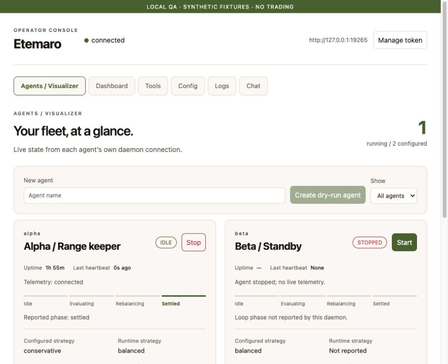
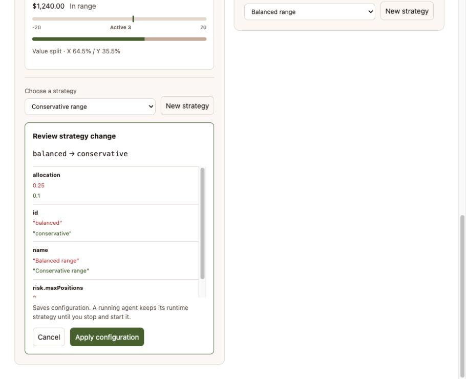

# apps/web — Etemaro Browser Console (React + Vite)

Single-page React app for the Etemaro daemon, built with Vite and served by the
daemon's IPC server on the same port as the WebSocket (default
`http://127.0.0.1:8765/`). No separate web process is required.

## Develop

```bash
pnpm --filter @etemaro/web dev     # Vite dev server on http://127.0.0.1:5173
```

In dev the app talks to the daemon at `http://127.0.0.1:8765` (override with
`VITE_DAEMON_URL`). Start the daemon with `etemaro serve` or `pnpm run dev`.

## Build

```bash
pnpm --filter @etemaro/web build   # emits apps/web/dist
```

`IpcServer` serves `apps/web/dist` statically, and `pnpm -r build` builds it as
part of the workspace. The root `pre-commit` hook builds before running tests.

## Views

- **Agents** — one-click create, start, stop, and re-target an agent's strategy. Backed by `/api/agents*`.
- **Dashboard** — live state snapshot (PnL, positions, cycle timers).
- **Tools** — the full agent tool catalog with JSON-Schema-driven forms; protected tools require an explicit confirm.
- **Logs / Chat** — live log stream and a direct line to the agent.

## Agent Visualizer

The default Agents view uses the Etemaro palette and connects to each running
child's dedicated `ipcPort`, retaining the configured daemon hostname and secure
WebSocket scheme. It never substitutes the parent snapshot for a child. Stopped
or disconnected agents show unavailable metrics. Explicit identity mismatches
are rejected; older daemons without a child port must be updated for live cards.

The header manages the browser-local `etemaro.token`. Changing or forgetting it
clears connection data and view state. Authentication rejection (WebSocket1008)
stops retries until the token changes; transient failures use jittered backoff.
Logs are bounded and batched, with severity derived from the existing category
convention plus category/text filters. Tools expose copyable outputs and reset
write confirmation when a different tool is selected.

Selecting a strategy reads both `get_strategy` payloads and shows a field diff.
Cancel sends no mutation. **Apply configuration** saves only after explicit
confirmation. A running agent keeps its runtime strategy until stopped and
started; both configured and reported runtime IDs are shown. There is no hidden
automatic restart. Start refuses a child that is still stopping to avoid racing
the old process's IPC port.

Snapshots add optional identity, boot/observation timestamps, actual agent-loop
phase, last tool and latest recorded decision. Phase follows real structured loop
and tool events, including parallel writes; it is not animated or inferred by the
browser. Bin ranges come from measured live positions matched by exact position
address. USD asset split is shown only when both side values are reported. The
RPC PnL adapter now forwards those values from existing balance/price calculations;
providers lacking them remain unavailable. Confidence is displayed only when the
decision log supplies a number in0–1. No new chain requests or fictitious defaults
are introduced for these indicators.

### Local verification

```bash
cd apps/web
npm run typecheck
npm run build
```

Root `pnpm test` also discovers web helper/connection tests. Fake-socket tests
cover authentication, reconnection, identity isolation and disposal. Daemon tests
cover actual event transitions, exact position matching, missing telemetry and
supervisor endpoints. These checks do not execute live trading.

The screenshots below use a separate local QA server with explicitly synthetic
fixtures, not live balances or a production daemon. The stopped second agent has
no copied positions or PnL. The preview shows a proposed change before applying.





## HTTP API (served by IpcServer)

| Method | Path | Description |
| --- | --- | --- |
| GET | `/api/health` | Liveness + agent id + tool count (public) |
| GET | `/api/state` | Latest state snapshot |
| GET | `/api/tools` | Tool catalog |
| POST | `/api/tool` | Invoke a tool: `{ "name", "args", "confirm" }` |
| GET | `/api/agents` | List configured agents with running state |
| POST | `/api/agents` | Create an agent: `{ "name" }` |
| POST | `/api/agents/:id/start` | `/stop` | Start / stop an agent child process |
| POST | `/api/agents/:id/strategy` | Set the agent's active strategy |

The browser WebSocket uses the shared IPC protocol (`subscribe:logs`,
`subscribe:state`, `command:chat`, `command:tool`).

## Security

- The daemon binds `127.0.0.1` by default (`connection.ipcHost` to override).
- With `connection.ipcToken`, HTTP needs `Authorization: Bearer` (or `?token=`) and WebSocket clients must `auth` first.
- State-changing tools require `confirm: true`; created agents default to **dry-run**.
- Wallet keystore and `.env` secrets are never exposed through this API.
